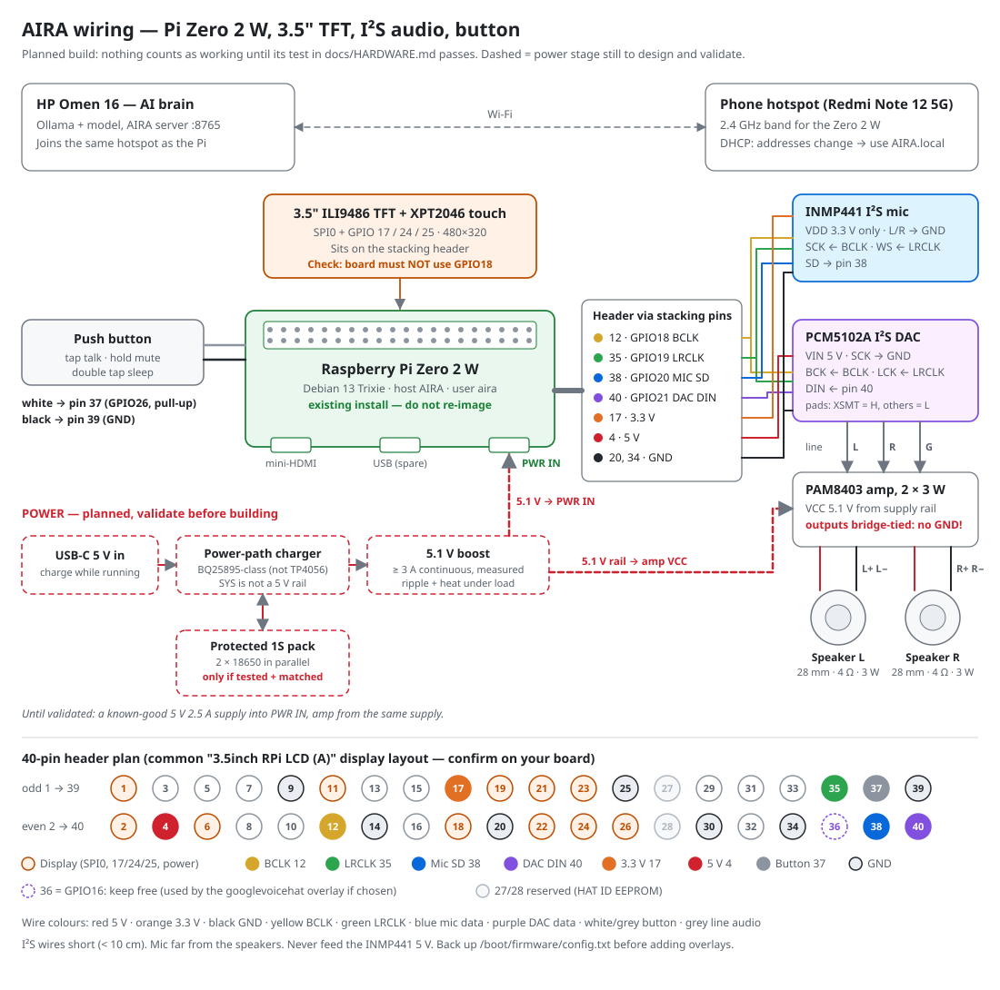

# AIRA — Autonomous Intelligent Responsive Assistant

A physical desktop AI companion: the **HP Omen 16** runs the brain (local LLM, speech,
tools, memory) and a **Raspberry Pi Zero 2 W** with a 3.5" ILI9486 screen is her face,
ears and voice. She speaks English, Tamil and Tanglish.

The full engineering design (architecture, technology choices, voice comparison, model
feasibility, roadmap, threat model, shopping list) is in **docs/DESIGN.md**.

## Status

| Phase | Scope | State |
|---|---|---|
| **P1** | AI brain: Ollama + Gemma 4, FastAPI server, conversation, benchmarks | **Implemented; needs your on-hardware benchmark** |
| **P2** | Voice technology bake-off (STT/TTS/wake word) | **Tooling implemented; run it on your laptop** (docs/PHASE2_VOICE_BAKEOFF.md) |
| P3 | Agent engine: allowlisted tools, confirmations, audit | Planned |
| P4 | Voice pipeline in production | Planned |
| P5 | Raspberry Pi face, audio and controls | Planned |
| P6 | Pi ↔ laptop link: pairing, TLS WebSocket, reconnection | Planned |
| P7 | Long-term memory | Planned |
| P8 | Cybersecurity assistant, reminders, automation | Planned |
| P9 | Integration, hardening, release | Planned |

## Talk to AIRA in a browser (prototype)

Open AIRA's web voice interface on the laptop or your phone and talk using that device's microphone and speaker:
**[HOW-TO-RUN.md](HOW-TO-RUN.md)**.

## Phase 1 quick start (Windows 11, PowerShell, repo root)

```powershell
winget install Ollama.Ollama                 # if not installed
ollama pull gemma4:e4b-it-qat                # primary candidate (fits 8 GB VRAM)
ollama pull gemma4:12b-it-qat                # contender for the benchmark
Set-ExecutionPolicy -Scope Process Bypass
.\scripts\setup_windows.ps1                  # venv, deps, .env with API key, Ollama env vars
.\.venv\Scripts\Activate.ps1
python scripts\check_environment.py          # must show 0 FAIL
python -m pytest                             # unit + end-to-end tests
python scripts\benchmark_llm.py              # writes benchmarks\llm-<time>.md
.\scripts\run_server.ps1                     # starts AIRA on http://127.0.0.1:8765
python scripts\chat_cli.py                   # second window: talk to her
```

Model tags: Gemma 4 tags on Ollama have been reported inconsistently across sources.
If a pull fails, run `ollama list` / check https://ollama.com/library/gemma4 and set
`AIRA_LLM_MODEL` to the exact tag you installed.

Details: docs/INSTALLATION.md · API: docs/API.md · Phase 1 sign-off: docs/PHASE1_ACCEPTANCE.md

## Phase 2 quick start (voice bake-off)

```powershell
pip install -r requirements-voice.txt
# put AIRA_AZURE_SPEECH_KEY / AIRA_AZURE_SPEECH_REGION in .env
python scripts\bakeoff\run_tts.py --sentences en01 ta01 tg01   # smoke test
python scripts\bakeoff\record_stt.py                              # record your 50 utterances
python scripts\bakeoff\run_stt.py --with-llm
```

Full procedure and acceptance criteria: docs/PHASE2_VOICE_BAKEOFF.md

## Hardware

Current state of the Pi and every part (verified vs planned): **docs/PROJECT_STATE.md**.
Parts, I²S audio wiring, GPIO pin plan, planned battery stage and step-by-step bring-up: **docs/HARDWARE.md**.
The Pi already runs Debian 13 (Trixie) — keep that installation; start with `bash raspberry_pi/collect_baseline.sh` on the Pi.
To type on the Pi from your phone over Wi-Fi: **raspberry_pi/wifi_keyboard/README.md**.



## Repository layout

```
laptop_server/      AI brain (runs on the HP Omen)
  config.py         all settings, env-overridable (AIRA_*)
  app.py, main.py   FastAPI app factory and entry point (python -m laptop_server)
  llm/              provider interface + Ollama implementation
  agent/            persona prompt, conversation manager   (tool calling: Phase 3)
  api/              REST + SSE routes, web voice routes (pairing, transcribe, speak)
  web/              the browser voice interface (single page)
  security/         API-key auth, browser pairing          (device pairing: Phase 6)
  monitoring/       JSON logs, audit log, rolling latency metrics
  voice/            sentence + Tamil/English script splitting, audio, CER/WER,
                    TTS (Azure, Piper, Indic Parler) and STT (faster-whisper) providers
  tools/ memory/    placeholders for later phases
shared/protocol/    versioned JSON envelope shared by server and devices
raspberry_pi/       Pi client (Phase 5); collect_baseline.sh (read-only system report),
                    check_hardware.py (display, touch, I²S audio, button, Wi-Fi, power)
  wifi_keyboard/    phone-as-keyboard over Wi-Fi: web page → WebSocket → uinput (paired, sandboxed)
scripts/            setup, run, environment check, benchmark, CLI chat, make_dev_cert (HTTPS)
  bakeoff/          Phase 2: test sets, recorder, TTS/STT runners, blind rating + scoring
tests/              unit/, integration/ (incl. Ollama emulator), hardware/
docs/               DESIGN, PROJECT_STATE, HARDWARE (parts, wiring diagram, pin plan, bring-up),
                    INSTALLATION, API, PHASE1_ACCEPTANCE, PHASE2_VOICE_BAKEOFF
```

## Security defaults

Binds to 127.0.0.1 only; LAN binding needs `AIRA_ALLOW_LAN=true`. Every endpoint except
`/api/v1/health` needs the API key. Conversation text is not written to logs unless
`AIRA_LOG_CONVERSATION_CONTENT=true`. Failed auth goes to `logs/audit.jsonl`. Keep Ollama
on localhost (do not set `OLLAMA_HOST=0.0.0.0`).
