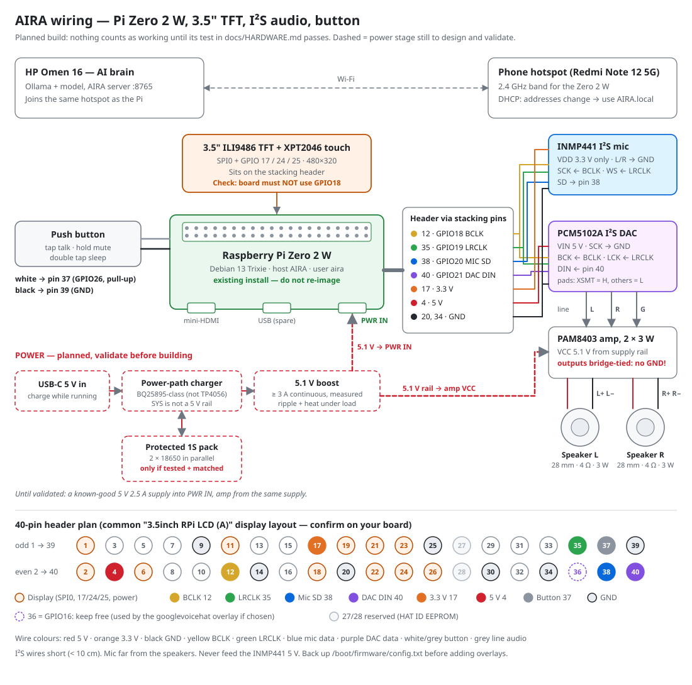
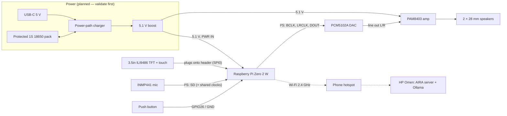

# AIRA hardware: parts, wiring, pin plan and bring-up

All AI runs on the HP Omen. The Raspberry Pi Zero 2 W (Debian 13 Trixie, already
installed and working; **do not re-image**) is AIRA's face, ears and voice. Current state
of every part: [`PROJECT_STATE.md`](PROJECT_STATE.md).

> **Status:** everything in this guide is the *planned* build. A part counts as working only
> after its test in section 6 passes. Pin numbers assume the common "3.5inch RPi LCD (A)"
> display layout; confirm your board before soldering.





## 1. Parts

| Part | Status | Role | Notes |
|---|---|---|---|
| Raspberry Pi Zero 2 W Rev 1.0, Debian 13, 64 GB microSD | **Verified working** | AIRA's body | Keep the existing OS |
| HP Omen 16 (RTX 4060 8 GB) | Verified | All AI | |
| 3.5" ILI9486 TFT + XPT2046 touch (SPI) | Owned, not tested | Face + touch | Identify the exact board/revision |
| INMP441 I²S MEMS microphone breakout | Planned | Ears | 3.3 V only |
| PCM5102A I²S DAC breakout (e.g. GY-PCM5102) | Planned | Digital → line-level audio | Check its configuration pads (section 4.3) |
| PAM8403 class-D stereo amplifier (5 V, 3 W/ch) | Planned | Drives the speakers | Bridge-tied outputs (section 4.4) |
| 2 × 28 mm speakers, 4 Ω, 3 W | Planned | Voice | |
| Momentary push button (6 × 6 mm, normally open) | Planned | Talk / mute / sleep | |
| 2×20 **stacking header** | Planned, strongly recommended | Gives access to the pins the display covers | 13 header connections are needed besides the display |
| USB-C input, power-path charger, protected 1S pack, 5.1 V boost | Planned, **not yet designed** | Charge while running | Section 5; safety rules apply |
| 2 × used `MR 18650-2000mAh` cells | Owned, **condition unknown** | Battery | Test before any use |
| Known-good 5 V 2.5 A micro-USB supply | Needed for bring-up | Bench power | Use this until the battery stage is validated |

## 2. Combined GPIO pin plan

Physical pin (BCM GPIO). No GPIO is shared between the display, the I²S audio and the
button. Shared 3.3 V, 5 V and ground pins are normal.

| Pin | GPIO | Owner | Signal | Pin | GPIO | Owner | Signal |
|---|---|---|---|---|---|---|---|
| 1 | — | Display | 3.3 V | 2 | — | Display | 5 V |
| 3 | 2 | free | | 4 | — | DAC | 5 V (DAC VIN) |
| 5 | 3 | free | | 6 | — | Display | GND |
| 7 | 4 | free | | 8 | 14 | free (UART TX) | |
| 9 | — | spare GND | | 10 | 15 | free (UART RX) | |
| 11 | 17 | Display | Touch IRQ | **12** | **18** | **I²S** | **BCLK → mic SCK + DAC BCK** |
| 13 | 27 | free | | 14 | — | spare GND | |
| 15 | 22 | free | | 16 | 23 | free | |
| 17 | — | Mic | 3.3 V (INMP441 VDD) | 18 | 24 | Display | LCD data/command |
| 19 | 10 | Display | SPI0 MOSI | 20 | — | Mic | GND |
| 21 | 9 | Display | SPI0 MISO | 22 | 25 | Display | LCD reset |
| 23 | 11 | Display | SPI0 SCLK | 24 | 8 | Display | SPI0 CE0 (LCD) |
| 25 | — | spare GND | | 26 | 7 | Display | SPI0 CE1 (touch) |
| 27 | 0 | reserved (HAT ID) | | 28 | 1 | reserved (HAT ID) | |
| 29 | 5 | free | | 30 | — | spare GND | |
| 31 | 6 | free | | 32 | 12 | free | |
| 33 | 13 | free | | 34 | — | DAC | GND |
| **35** | **19** | **I²S** | **LRCLK → mic WS + DAC LCK** | 36 | 16 | reserved* | leave unconnected |
| **37** | **26** | **Button** | input, internal pull-up | **38** | **20** | **I²S** | **DIN ← mic SD** |
| **39** | — | **Button** | GND | **40** | **21** | **I²S** | **DOUT → DAC DIN** |

\* The `googlevoicehat-soundcard` overlay, one candidate for full-duplex audio, drives
GPIO16 as an amplifier-enable output. Keep pin 36 free in case that overlay is used.

**Conflicts to rule out before wiring**

| Risk | Check |
|---|---|
| Some 3.5" board revisions use **GPIO18 for the backlight**, which would clash with I²S BCLK | Read the board's pin labels/wiki. If it uses GPIO18, the backlight must be hard-wired on, or use a different board |
| Display covers all 40 pins | Fit the stacking header first; solder module wires to its long pins |
| `dtparam=audio=on` in `config.txt` | Leave it: on the Zero 2 W it only provides HDMI audio and does not touch GPIO 18–21. It does **not** configure the I²S modules |
| Serial console (`console=serial0` in `cmdline.txt`) uses pins 8/10 | Not used by AIRA's plan; no change needed |

## 3. Wire colour code (matches the diagram)

| Colour | Use |
|---|---|
| Red | 5 V / 5.1 V |
| Orange | 3.3 V |
| Black | Ground |
| Yellow | I²S BCLK (pin 12) |
| Green | I²S LRCLK (pin 35) |
| Blue | Microphone data (pin 38) |
| Purple | DAC data (pin 40) |
| White | Button signal (pin 37) |
| Grey | Line-level audio (DAC → amp) |

## 4. Module wiring

Keep I²S wires short (under ~10 cm), twist each data or clock wire with a ground wire if
it runs long, and do every step with the power **off**.

### 4.1 Display + touch (HAT)

Plugs onto the stacking header; no wires. Signals as in section 2 (SPI0 + GPIO17/24/25).

### 4.2 INMP441 microphone

| INMP441 pin | Connect to | Pi pin |
|---|---|---|
| VDD | 3.3 V | 17 |
| GND | GND | 20 |
| L/R | GND (selects the **left** channel) | GND |
| SCK | BCLK | 12 (GPIO18) |
| WS | LRCLK | 35 (GPIO19) |
| SD | I²S data in | 38 (GPIO20) |

3.3 V only; never connect it to 5 V. Mount it with its sound port facing out of the
enclosure and as far from the speakers as the case allows.

### 4.3 PCM5102A DAC (typical GY-PCM5102 breakout)

| DAC pin | Connect to | Pi pin |
|---|---|---|
| VIN | 5 V (board has its own regulators; check yours) | 4 |
| GND | GND | 34 |
| BCK | BCLK | 12 (GPIO18), shared with the mic |
| LCK | LRCLK | 35 (GPIO19), shared with the mic |
| DIN | I²S data out | 40 (GPIO21) |
| SCK | GND — the DAC then makes its own clock | GND |

On the back of most GY-PCM5102 boards are four solder-jumper pads. The usual settings are
**FLT = L, DEMP = L, XSMT = H (un-muted), FMT = L (I²S)**. Some boards ship with pads
open; confirm against your board's silkscreen before bridging.

### 4.4 PAM8403 amplifier + speakers

| From | To |
|---|---|
| DAC L out / R out / AGND (pads or 3.5 mm jack) | PAM8403 L in / R in / G in |
| 5.1 V rail (from the supply, **not** through the GPIO header) | PAM8403 VCC |
| Ground | PAM8403 GND |
| PAM8403 L+ / L− | Speaker 1 (+ / −) |
| PAM8403 R+ / R− | Speaker 2 (+ / −) |

The outputs are bridge-tied: **never connect L−, R− or any speaker terminal to ground, and
never join L− to R−.** Start testing at low volume. Feeding the amplifier from the supply
rather than the header keeps its current pulses off the Pi's 5 V pins.

### 4.5 Push button

| Button leg | Pi pin |
|---|---|
| 1 | 37 (GPIO26), internal pull-up, pressed = low |
| 2 | 39 (GND) |

No resistor needed. Tap = talk, hold 1 s = mute or unmute the microphone, double tap = sleep or wake.

## 5. Power (planned — not designed or validated yet)

Target: USB-C charging **while AIRA runs**.

```
USB-C 5 V ──► power-path charger ──► SYS ──► 5.1 V boost (≥ 3 A continuous, validated) ──► Pi PWR IN + PAM8403
                    ▲  │
                    └──┴── protected 1S pack (2 × 18650 in parallel, only if tested and matched)
```

Rules that are not optional:

- Test each used 18650 on its own (capacity, internal resistance, voltage under load) before any pack is built. The same printed model does not mean matched cells. Never parallel cells at different voltages. Discard swollen, damaged, leaking or hot cells.
- A TP4056 board on its own is **not** a charge-while-running solution. A BMS is not a voltage regulator. A BQ25895-class power-path charger handles load sharing, but its SYS output is **not** a regulated 5.1 V rail: a separate boost stage is needed.
- A boost board's advertised switch current is not its continuous output current. Measure output voltage, ripple and temperature at the real load (Pi + display + amplifier at volume).
- Protection, a fuse and insulation are required; nickel strips are spot-welded, not soldered to bare cells.
- Rough runtime with two healthy 2000 mAh cells (about 12.5 Wh usable, not validated): ~4 h at 3 W, ~2.5 h at 5 W.
- This stage will probably take most of, or more than, the ₹1,000 extra-parts budget on its own.

**Until this is validated, power the Pi from a known-good 5 V 2.5 A supply into PWR IN.**

## 6. Bring-up and tests (one module at a time)

**Shortcut:** `raspberry_pi/setup_audio.sh` does the steps below for you (check only by default;
`--dac`, `--duplex`, `--test`, `--undo`), with a backup before every change.

Each block says where it runs. **Back up `config.txt` before any change** and add only one
overlay per test:

```bash
# [AIRA]
sudo cp /boot/firmware/config.txt /boot/firmware/config.txt.bak-$(date +%Y%m%d-%H%M)
```

### 6.0 Baseline (nothing wired yet)

```bash
# [AIRA] — from the repo copied to the Pi, or paste the script
bash raspberry_pi/collect_baseline.sh      # writes ~/aira-baseline-<time>.txt, no secrets
```

### 6.1 Network + SSH

```powershell
# [Windows PowerShell] — laptop connected to the same phone hotspot as the Pi
ping AIRA.local
ssh aira@AIRA.local
```

If `AIRA.local` does not resolve, take the Pi's address from the hotspot's connected-devices
list. Some phones isolate hotspot clients from each other; if ping fails both ways, try
another hotspot or a home router.

### 6.2 Display, then touch — ✅ done 31 Oct 2026

Working setup, recorded in full in
[`journal/2026-10-31-display-setup.md`](journal/2026-10-31-display-setup.md). **Read the
journal before changing anything display-related.**

| Item | Confirmed |
|---|---|
| Panel | HSD035577C3, ILI9486 + XPT2046 (exposed as `ti,ads7846`), 480 × 320 RGB565 |
| Overlay | vendor `tft35a`: `dtoverlay=tft35a:rotate=90` (SPI0, 16 MHz, DC GPIO24, reset GPIO25, touch IRQ GPIO17) |
| KMS | `dtoverlay=vc4-kms-v3d` commented out |
| Framebuffer | `/dev/fb1` = `fb_ili9486`; VT1 mapped to it by `aira-tft-console.service` (`con2fbmap 1 1`) |
| Touch | ADS7846 input device present; no touch UI yet |
| Pins | Exactly the (A) layout in section 2. No backlight GPIO listed, so GPIO 18–21 (I²S) and 26 (button) stay free |

Do **not** rerun `LCD35-show`. Before wiring audio, confirm GPIO18–21 are still unused by the
display at runtime:

```bash
# [AIRA]
pinctrl get 16-21,26        # expect input/none on all of them while the TFT is working
```

### 6.3 Audio, in order

1. **DAC only.** Wire 4.3 (no amplifier, no mic). Add `dtparam=i2s=on` and `dtoverlay=hifiberry-dac` on new lines **below** the existing `dtoverlay=tft35a:rotate=90` (leave that line and the commented-out `vc4-kms-v3d` alone), then reboot. Check the TFT still shows the console before going on.
   Pass: `aplay -l` lists the card; headphones on the DAC jack play `speaker-test -D plughw:<card>,0 -c 2 -t wav`.
2. **Amplifier + speakers.** Wire 4.4, powered from the bench supply. Pass: clear speech at moderate volume, no buzz when idle, amplifier only warm.
3. **Microphone.** Wire 4.2. For playback and capture together on one I²S bus, replace `hifiberry-dac` with **one** full-duplex overlay. Candidate: `dtoverlay=googlevoicehat-soundcard` (drives GPIO16; pin 36 stays free). Pass:
   ```bash
   arecord -l
   arecord -D plughw:<card>,0 -c 2 -r 48000 -f S32_LE -d 5 mic.wav   # mic is the left channel
   aplay -D plughw:<card>,0 mic.wav
   ```
   If a format is refused, `arecord -D plughw:<card>,0 --dump-hw-params -d 1 /dev/null` lists what the driver accepts. If no stock overlay gives full duplex, the fallback is a small custom `simple-audio-card` overlay (Phase 5 task).
4. **Full duplex.** Play and record at once; confirm neither stutters. Echo cancellation comes later, in software (Phase 4).

### 6.4 Button

```bash
# [AIRA]
sudo apt install -y python3-gpiozero
python3 raspberry_pi/check_hardware.py --pin 26
```

### 6.4b Wireless joystick (ESP32 + KY-023)

Not wired to the Pi: an ESP32 WROOM reads a KY-023 joystick (VCC 3.3V, GND, VRX GPIO32,
VRY GPIO33, SW GPIO27) and sends navigation events to the Pi over the same 2.4 GHz hotspot.
Firmware, wiring and the three test stages: [esp32_joystick/README.md](../esp32_joystick/README.md).

### 6.5 Everything

`python3 raspberry_pi/check_hardware.py` checks power flags, Wi-Fi, display, touch, I²S
playback and capture, and the button, then prints a table for section 7.

## 7. Hardware record (fill in as tests pass)

| Item | Value | Test passed (date) |
|---|---|---|
| Display board / revision | HSD035577C3 panel, ILI9486 + XPT2046 | 31 Oct 2026 |
| Display overlay used | `tft35a:rotate=90` (vendor); `/dev/fb1` `fb_ili9486`; VT1 → fb1 | 31 Oct 2026 |
| Display uses GPIO18? (must be no) | No backlight GPIO in the overlay; confirm with `pinctrl get 18` | |
| Touch overlay used | part of `tft35a` (ADS7846 on spi0.1, IRQ GPIO17) | detected, not calibrated |
| Audio overlay used | | |
| ALSA card name / number | | |
| Mic format that works (rate / bits) | | |
| Button pin (BCM) | 26 (planned) | |
| Bench supply / battery stage | bench 5 V 2.5 A (planned) | |
| `vcgencmd get_throttled` under full load | | |

## 8. Troubleshooting

| Symptom | Likely cause / fix |
|---|---|
| White screen on the TFT | Overlay line changed or lost: compare `config.txt` with the journal; `dmesg | grep -i -E 'ili9486|fbtft|spi'` |
| TFT stays blank after boot but `/dev/fb1` exists | VT1 not mapped: `systemctl status aira-tft-console`, then `sudo con2fbmap 1 1 && sudo chvt 1` |
| Display works until audio is enabled | The board uses GPIO18 (backlight); see section 2 |
| `aplay -l` shows only HDMI (`vc4hdmi`, or `bcm2835 HDMI` since KMS is off) | `dtparam=i2s=on` / audio overlay missing, or typo in `config.txt` |
| Silence from the DAC | SCK not grounded, XSMT low (muted), or BCK/LCK swapped |
| Recording is silent or all zeros | Mic on 5 V (damaged), L/R floating, SD on the wrong pin, or reading the right channel |
| Loud hum or buzz | Amplifier powered through the header, or a ground loop; feed it from the supply, keep audio grounds short |
| Random reboots, Wi-Fi drops | Under-voltage: `vcgencmd get_throttled` must print `0x0` |
| Booting fails after a change | Put the SD card in a reader and restore `config.txt.bak-*` on the `bootfs` partition |
